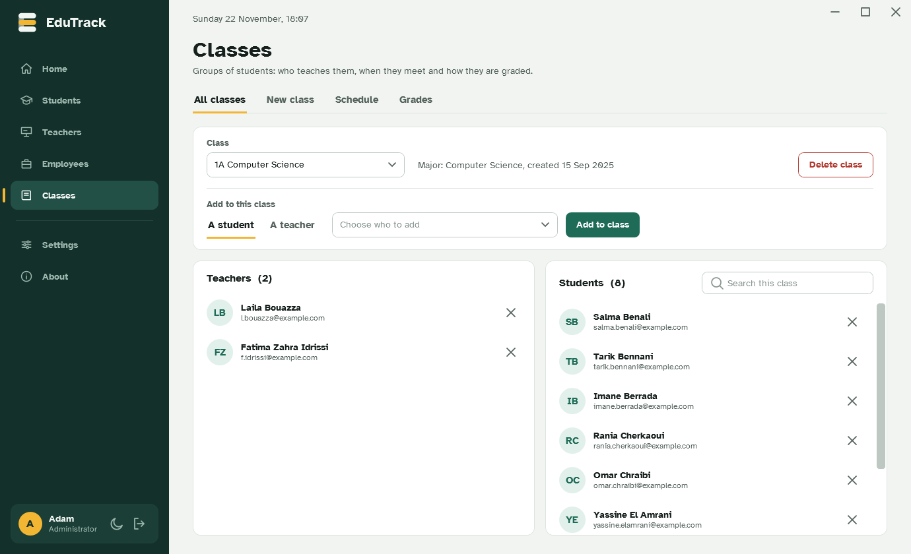
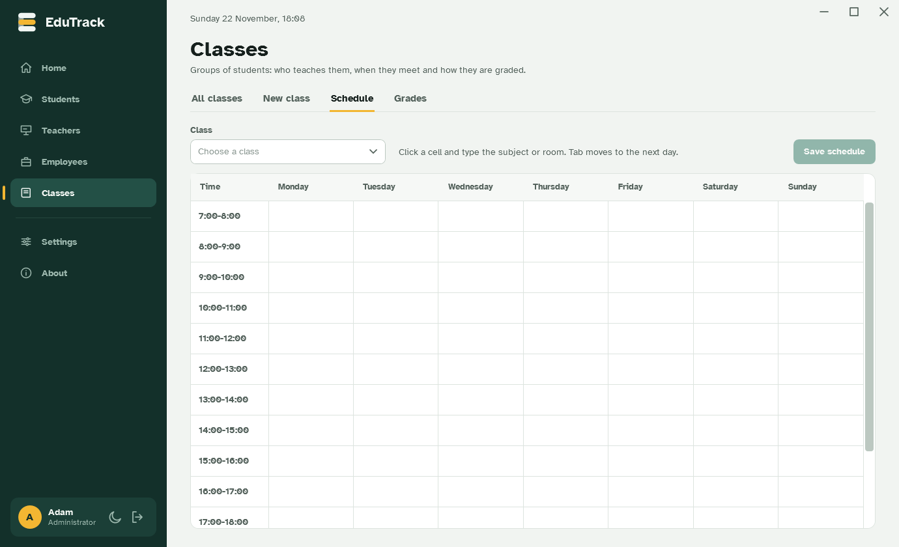
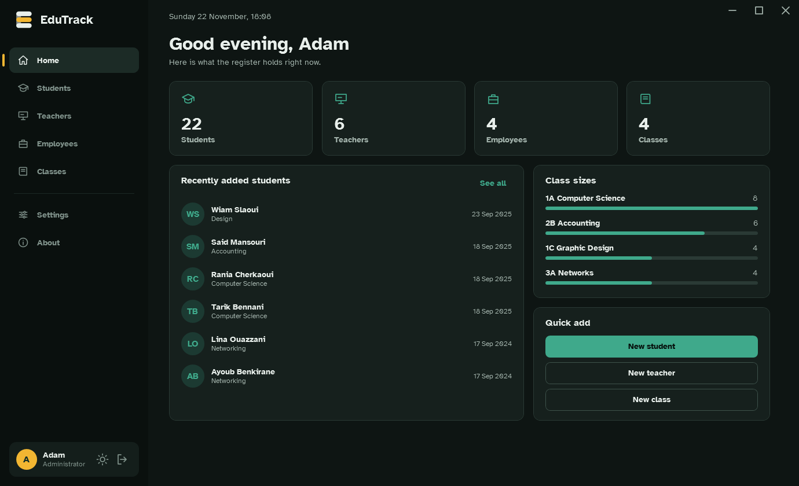
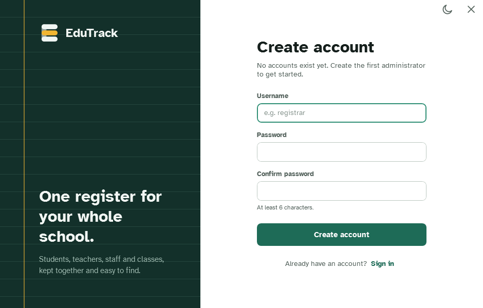

# EduTrack

EduTrack is a Windows desktop register for schools and training centres. It keeps students, teachers, staff and classes in one place: who they are, which documents you hold, who is in which class, when each class meets and how students are graded.


## What you can do

- **Students, teachers and employees**: search by name, open a record, edit it, attach scans of ID cards, contracts, resumes and diplomas, delete it.
- **Classes**: see who is in a class, add or remove students and teachers, plan the weekly timetable and enter grades per module.
- **Home**: live counts, the newest students, class sizes and quick add shortcuts.
- **Backup and restore**: save a list to an XML file and restore it later.
- **Three themes**: Classic (the original dark blue look, the default), Paper (light green) and Slate (dark green). Pick one in Settings, or cycle with the button in the sidebar. EduTrack remembers your choice.
- **Keyboard**: `Ctrl+1` to `Ctrl+7` jump between Home, Students, Teachers, Employees, Classes, Settings and About.

| Students | New student |
| --- | --- |
|  |  |

| Class roster | Weekly schedule |
| --- | --- |
|  |  |

| Dark theme | First run |
| --- | --- |
|  |  |

## Installation

1. **Install a MySQL-compatible server.** XAMPP ([Apache Friends](https://www.apachefriends.org/index.html)), MySQL or MariaDB all work. Start MySQL (in XAMPP, press Start next to MySQL).
2. **Create the database.** Open phpMyAdmin (or any MySQL client), create a database named `database`, select it and import `datebase.sql` from this repository.
3. **Run EduTrack.** Open `EduTrack.sln` in Visual Studio 2022 and press F5, or build from a terminal:

   ```
   msbuild EduTrack.sln -restore -p:Configuration=Release
   ```

   The program is `EduTrack\bin\Release\EduTrack.exe`.
4. **Create your account.** On a new database the sign-in window opens in "Create account" mode. Choose a username and a password of at least 6 characters.

If the database is somewhere else, or has a different name or password, edit the `appSettings` in `EduTrack.exe.config` (or `App.config` before building):

```xml
<add key="Db.Server" value="127.0.0.1" />
<add key="Db.Port" value="3306" />
<add key="Db.Name" value="database" />
<add key="Db.User" value="root" />
<add key="Db.Password" value="" />
```

On start-up EduTrack checks the connection and tells you what is wrong if it can't reach the database.

## Notes for upgrading from the 2024 version

- Passwords are now stored as salted hashes. Existing accounts keep working and are upgraded the first time they sign in.
- On start-up EduTrack makes two small, repeatable changes to an older database: it widens `login.Password` so a hash fits, and it adds a unique key on `student_module (StudentID, ModuleID)` so saving grades updates a grade instead of duplicating it.
- Saving a student, teacher or employee with an empty date now stores an empty date instead of `0001-01-01`.
- The README used to say the database is called `datebase`; the program has always connected to `database`.

## Design

The default theme, Classic, keeps the original charcoal and cyan colours. The optional "Paper and chalk" themes use a chalkboard-green sidebar, paper-white (or dark) pages and one pencil-yellow accent. All colours live in `EduTrack/Styles/Theme.Classic.xaml`, `Theme.Light.xaml` (Paper) and `Theme.Dark.xaml` (Slate), and every control (buttons, inputs, tables, scroll bars) is styled in `Styles/Controls.xaml`, so changing the palette is a one-file edit.

Text is set in [Atkinson Hyperlegible](https://brailleinstitute.org/freefont), designed by the Braille Institute for legibility. It is bundled in `EduTrack/Fonts` under the SIL Open Font License.

## License

This project is licensed under the MIT License. See the LICENSE.txt file for details.

## Acknowledgements

EduTrack is supported by GitHub Student Pack and Expertus.ma.

## Contact

For more information, visit [GitHub](https://github.com/AdRohal/EduTrack-) or contact Adam Rohal at rohal.dev@hotmail.com .
